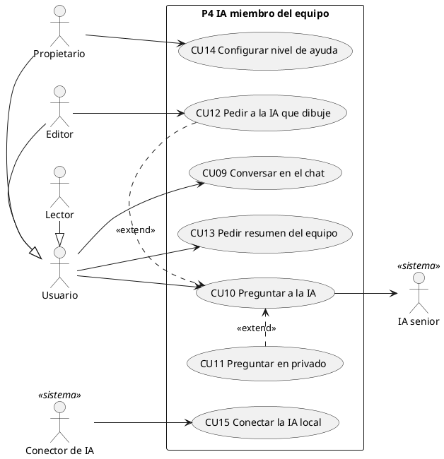
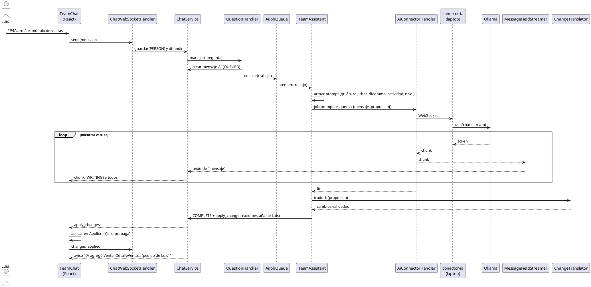
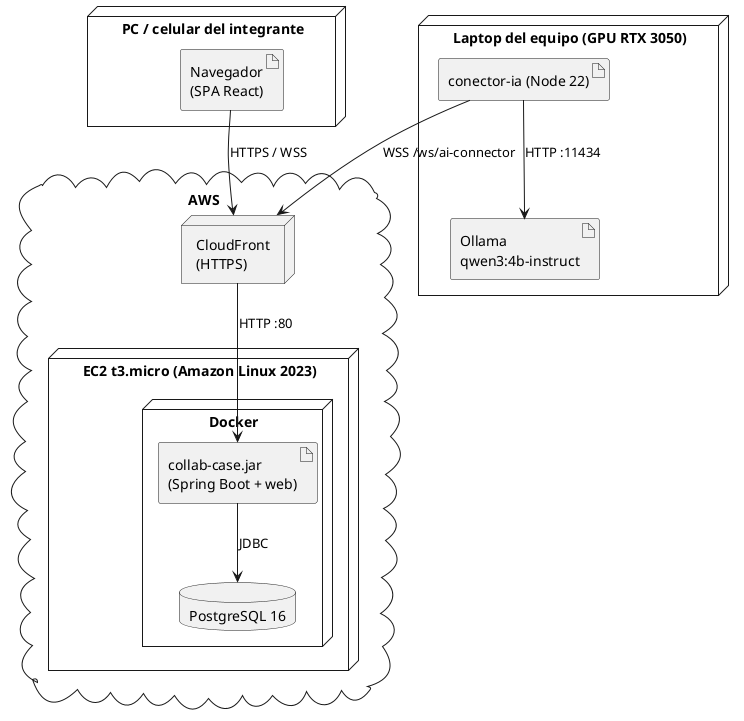

# Guía para documentar Collab CASE con el PUDS

Esta guía junta **todo lo que está implementado** en Collab CASE, ordenado como lo pide el
**Proceso Unificado de Desarrollo de Software (PUDS)**, para que escribir el documento sea
sobre todo copiar, completar y dibujar. Cada sección dice **qué artefacto va**, **de dónde
sacar la información en el repo** y trae el contenido ya armado.

> App en producción: **https://d2x41sl49sltgo.cloudfront.net**
> Repositorio: **https://github.com/santiagoarteaga0704/collab_case** (rama `main`)

---

## 0. Qué tienes con el repo (y qué no)

**Con clonar el repo tienes todo el código y la documentación técnica:**

| Carpeta / archivo | Qué es |
|---|---|
| `backend/` | API Spring Boot 4.1.1 + Java 21 (todo el servidor) |
| `frontend/` | Web React + Vite (editor UML Apollon + Yjs) |
| `mobile-template/` | App Flutter offline que acompaña al backend que genera la herramienta |
| `conector-ia/` | Programa Node que une la IA local (Ollama) de la laptop con el servidor |
| `local-stt/` | Servidor local de voz a texto (desarrollo) |
| `docs/superpowers/specs/2026-10-23-ia-miembro-del-equipo-design.md` | **Diseño completo de la IA como miembro del equipo** (léelo, es la mejor fuente) |
| `docs/superpowers/plans/2026-10-23-ia-miembro-del-equipo.md` | Plan de implementación en 15 tareas |
| `docs/despliegue-aws.md` | Cómo está desplegado en AWS |
| `ANALISIS-BACKEND.md` | Análisis del backend original y bugs corregidos |
| `Dockerfile`, `compose.aws.yml` | Imagen única y despliegue |

**Lo que NO está en git (a propósito) y no necesitas para documentar:**

- Secretos de producción (`.env.aws.servidor`): contraseña de la base, JWT, secreto del conector.
- La llave SSH del servidor y el acceso a la cuenta de AWS (los tiene Santiago).
- El modelo de IA (`qwen3:4b-instruct`) vive en Ollama en la laptop de Santiago.

Para probar la app no hace falta nada de eso: entra a la URL de producción, crea una cuenta y
listo. Para que la IA responda, la laptop de Santiago tiene que tener el conector prendido.

---

## 1. Cómo usar el PUDS en este documento

El PUDS es **iterativo e incremental**, **dirigido por casos de uso** y **centrado en la
arquitectura**. Se organiza en **4 fases** y en cada una se recorren **5 flujos de trabajo**:

| Flujo de trabajo → | Requisitos | Análisis | Diseño | Implementación | Pruebas |
|---|---|---|---|---|---|
| **Inicio** | ●●● | ●● | ● | | |
| **Elaboración** | ●● | ●●● | ●●● | ● | ● |
| **Construcción** | ● | ● | ●● | ●●● | ●●● |
| **Transición** | | | | ● | ●● |

Estructura sugerida del documento:

1. Introducción (problema, objetivo, alcance)
2. **Fase de Inicio**: modelo de negocio/dominio, actores, requisitos, modelo de casos de uso, riesgos
3. **Fase de Elaboración**: casos de uso expandidos, modelo de análisis, arquitectura, diseño
4. **Fase de Construcción**: modelo de diseño detallado, implementación, pruebas
5. **Fase de Transición**: despliegue, pruebas de aceptación, manual de usuario
6. Conclusiones y anexos

### Iteraciones reales (sacadas de `git log`)

| Iteración | Fecha | Qué se hizo | Fase PUDS |
|---|---|---|---|
| I1 | 21-oct-2026 | Base de Collab CASE: editor colaborativo, proyectos, versiones, exportes, codegen, móvil | Inicio/Elaboración |
| I2 | 22-oct-2026 | Corrección de bugs (codegen 1→N, sync móvil, locks, caché de roles) y rediseño visual del frontend | Elaboración |
| I3 | 23-oct-2026 | **IA como miembro del equipo**: chat, conector, cola, moderador, nivel de ayuda (32 commits) | Construcción |
| I4 | 25-oct-2026 | Imagen Docker única, despliegue en AWS (EC2 + CloudFront), prueba de punta a punta en producción | Transición |

---

## 2. FASE DE INICIO

### 2.1 Planteamiento del problema

Los equipos que modelan software lo hacen en herramientas CASE individuales (o se pasan
archivos), sin ver en vivo lo que hace el otro, y la IA, cuando existe, es un asistente
genérico que no sabe quién pregunta ni en qué está trabajando cada uno.

**Objetivo general:** desarrollar una herramienta CASE colaborativa en tiempo real, en la que
una **IA local actúa como un desarrollador senior más del equipo**: todos ven las preguntas y
respuestas, la IA sabe quién le habla y qué está haciendo, modera el trabajo y puede dibujar
directamente en el diagrama, con un nivel de ayuda configurable.

**Objetivos específicos** (cada uno está implementado):

1. Editar diagramas de clases UML entre varios usuarios en tiempo real, con bloqueo por elemento.
2. Gestionar proyectos, versiones, diagramas y miembros con roles (propietario, editor, lector).
3. Integrar una IA local como miembro del equipo en un chat grupal por proyecto.
4. Permitir crear diagramas desde voz, desde una foto de pizarra y con un asistente de modelado.
5. Generar diagramas de secuencia a partir del diagrama de clases.
6. Exportar a JSON, PlantUML, SQL y XMI e importar XMI (Enterprise Architect).
7. Generar un backend Spring Boot ejecutable y una app móvil Flutter offline.
8. Desplegar en la nube (AWS) con HTTPS.

### 2.2 Actores

| Actor | Tipo | Descripción |
|---|---|---|
| **Visitante** | Humano | Persona sin cuenta: solo puede registrarse o iniciar sesión |
| **Usuario** | Humano | Persona registrada; puede crear proyectos (y pasa a ser propietario) |
| **Propietario (OWNER)** | Humano | Creó el proyecto. Todo lo del editor + gestionar miembros, versiones, borrar, cambiar el nivel de ayuda de la IA |
| **Editor (EDITOR)** | Humano | Miembro que puede modificar diagramas y pedirle a la IA que dibuje |
| **Lector (VIEWER)** | Humano | Miembro de solo lectura: ve diagramas y chat, puede preguntarle a la IA pero la IA nunca dibuja a su pedido |
| **IA senior** | Sistema (actor secundario) | Modelo `qwen3:4b-instruct` en Ollama; responde en el chat, modera y propone/aplica cambios |
| **Conector de IA** | Sistema | Programa en la laptop que lleva los trabajos del servidor a Ollama y devuelve la respuesta |
| **Usuario de la app generada** | Humano | Usa el backend/app móvil que la herramienta genera |
| **Enterprise Architect** | Sistema externo | Herramienta CASE con la que se intercambia XMI |
| **Groq** | Sistema externo | Servicio de voz a texto y visión en producción (opcional) |

> Generalización: Propietario, Editor y Lector **heredan de Usuario** (en el diagrama de CU se
> dibuja así). El rol es por proyecto: la misma persona puede ser propietaria de uno y lectora de otro.

### 2.3 Requisitos funcionales (RF)

| ID | Requisito | Dónde está en el código |
|---|---|---|
| RF-01 | Registrarse, iniciar sesión (JWT) y ver el perfil | `auth/AuthController` (`/api/auth/register`, `/login`, `/me`) |
| RF-02 | Crear, listar, renombrar, editar y eliminar proyectos | `project/ProjectController` |
| RF-03 | Invitar miembros por email, cambiar su rol y quitarlos | `project/ProjectMemberController` |
| RF-04 | Crear, renombrar y eliminar versiones de un proyecto; copiar diagramas de una versión a otra | `project/ProjectVersionController` |
| RF-05 | Crear, abrir, renombrar y eliminar diagramas de clases | `diagram/DiagramController`, `ProjectController` |
| RF-06 | Editar un diagrama entre varios usuarios **en tiempo real** (cursores/presencia incluidos) | `collaboration/*`, WS `/ws/collaboration/{diagramId}`, Yjs en el front |
| RF-07 | Bloquear el elemento que alguien está editando para que otro no lo pise | `collaboration/ElementLockManager` |
| RF-08 | **Chat del equipo por proyecto**, guardado en la base, visible para quien entra tarde | `teamai/chat/*`, WS `/ws/chat/{projectId}` |
| RF-09 | **Preguntarle a la IA con `@IA`**: responde por nombre a quien preguntó y en relación con lo que está haciendo | `teamai/chat/QuestionHandler`, `teamai/assistant/TeamAssistant` |
| RF-10 | **Preguntas privadas** a la IA (solo las ven el autor y la IA) | `ChatMessage.privateOwnerId` |
| RF-11 | **La IA dibuja**: arma clases/relaciones en el diagrama a pedido de un editor | `teamai/assistant/ChangeTranslator`, `frontend/src/services/teamChanges.js` |
| RF-12 | **Nivel de ayuda configurable** (EXPLAIN / SUGGEST / DRAW), solo lo cambia el propietario | `teamai/chat/HelpLevel`, `PUT /api/projects/{id}/chat/help-level` |
| RF-13 | **La IA modera**: sabe quién trabaja en qué, `@IA resumen` resume el trabajo del equipo | `teamai/activity/ActivityService` |
| RF-14 | Ver la respuesta de la IA escribiéndose en vivo y su estado (en cola, escribiendo, fallida) | `MessageFieldStreamer`, `ChatMessageStatus` |
| RF-15 | Asistente de modelado: revisar el diagrama y sugerir clases/atributos/relaciones aplicables | `ai/AiController` (`/api/ai/diagrams/{id}/analyze`) |
| RF-16 | Agente de ayuda: ejecutar acciones por lenguaje natural (crear proyecto, exportar, generar…) | `agent/CollabCaseAgentController`, `AgentActionRegistry` |
| RF-17 | Crear diagrama **desde una foto o captura** de pizarra | `vision/VisionController` |
| RF-18 | **Dictar por voz** las instrucciones | `speech/SpeechController` |
| RF-19 | Generar **diagramas de secuencia** a partir de un escenario y regenerarlos | `sequence/SequenceDiagramController` |
| RF-20 | Exportar a **JSON, PlantUML, SQL y XMI** (con vista previa) | `export/DiagramExportController` |
| RF-21 | Importar **XMI** de Enterprise Architect | `importer/DiagramImportController` |
| RF-22 | Validar el diagrama y **generar un backend Spring Boot** descargable (ZIP) | `codegen/CodeGenerationController` |
| RF-23 | Incluir en lo generado una **app móvil Flutter offline** con sincronización | `codegen/MobileProjectFiles`, `mobile-template/` |
| RF-24 | Registrar y ejecutar la app generada en el servidor (runtime: CRUD de registros + sync) | `runtime/*` |

### 2.4 Requisitos no funcionales (RNF)

| ID | Requisito | Cómo se cumple |
|---|---|---|
| RNF-01 | **IA local** (exigencia del docente) | Ollama en la laptop; el servidor nunca llama a una IA de texto en la nube (`ai.provider=conector`, `agent.provider=conector`) |
| RNF-02 | Tiempo real | WebSockets (Yjs para el diagrama, canal propio para el chat) |
| RNF-03 | Respuesta de la IA < 60 s | Medido en producción: 8–44 s (prueba de punta a punta) |
| RNF-04 | Seguridad | Contraseñas con hash, JWT, roles por proyecto validados en el servidor, secreto compartido para el conector, HTTPS |
| RNF-05 | Disponibilidad desde cualquier red | El conector abre el WebSocket **desde la laptop hacia el servidor**: no hay que abrir puertos |
| RNF-06 | Concurrencia de la IA | Una sola GPU: cola de trabajos de a uno, máximo 5 en espera |
| RNF-07 | Privacidad | Las preguntas privadas no llegan a nadie más, ni por WebSocket ni en el historial |
| RNF-08 | Portabilidad / despliegue | Una sola imagen Docker (web + API); `docker compose` con Postgres |
| RNF-09 | Usabilidad | Interfaz en castellano, estética de "lámina técnica", feedback de estado en cada acción |
| RNF-10 | Offline (móvil) | La app móvil guarda en SQLite local y sincroniza al reconectar; IA y voz offline en el teléfono |

### 2.5 Modelo de casos de uso

**Paquetes de casos de uso** (úsalos para no tener un solo diagrama gigante):

| Paquete | Casos de uso |
|---|---|
| **P1 Seguridad** | CU01 Registrarse · CU02 Iniciar sesión |
| **P2 Gestión de proyectos** | CU03 Gestionar proyectos · CU04 Gestionar miembros · CU05 Gestionar versiones · CU06 Gestionar diagramas |
| **P3 Modelado colaborativo** | CU07 Editar diagrama en tiempo real · CU08 Bloquear elemento (include de CU07) |
| **P4 IA miembro del equipo** | CU09 Conversar en el chat del equipo · CU10 Preguntar a la IA · CU11 Preguntar en privado (extend de CU10) · CU12 Pedir a la IA que dibuje (extend de CU10) · CU13 Pedir resumen del equipo · CU14 Configurar nivel de ayuda · CU15 Conectar la IA local |
| **P5 Asistentes** | CU16 Revisar diagrama con el asistente · CU17 Usar el agente de ayuda · CU18 Crear diagrama desde foto · CU19 Dictar por voz |
| **P6 Artefactos** | CU20 Generar diagrama de secuencia · CU21 Exportar diagrama · CU22 Importar XMI |
| **P7 Generación de código** | CU23 Validar y generar backend · CU24 Usar la app móvil generada · CU25 Ejecutar la app generada (runtime) |

Diagrama de CU del paquete principal (pégalo en https://www.plantuml.com/plantuml o en draw.io):



### 2.6 Riesgos identificados (y cómo se resolvieron)

| Riesgo | Mitigación aplicada |
|---|---|
| El modelo local es lento en CPU de servidor (40–60 s, >3 min con contexto) | La IA corre en la laptop con GPU (RTX 3050); el servidor solo encola |
| Modelos chicos cometen errores de UML | Se midieron 5 modelos; se eligió `qwen3:4b-instruct` (7–11 s, buen UML). El servidor valida todo lo que propone la IA |
| La laptop se desconecta | El conector reintenta solo (1 s, 2 s, 4 s… hasta 15 s); el chat muestra "IA desconectada" |
| Respuestas cortadas por un reinicio | Se marcan como fallidas y salen del historial de contexto |
| Dos pestañas aplican el mismo cambio dos veces | `apply_changes` se manda a una sola pestaña de quien pidió el cambio |
| Servidor gratuito con 1 GB de RAM | JVM a 512 MB, Postgres con 64 MB de buffers, 2 GB de swap |

---

## 3. FASE DE ELABORACIÓN

### 3.1 Casos de uso expandidos

Plantilla (usa la misma para todos):

| Campo | Contenido |
|---|---|
| Caso de uso | CUxx Nombre |
| Actores | Principal / secundarios |
| Propósito | |
| Resumen | |
| Precondiciones | |
| Flujo principal | Acción del actor / Respuesta del sistema, numerado |
| Flujos alternativos | |
| Postcondiciones | |
| Requisitos relacionados | RF-xx |

**Ejemplo completo — CU10 Preguntar a la IA**

| Campo | Contenido |
|---|---|
| Actores | Usuario (principal), IA senior y Conector de IA (secundarios) |
| Propósito | Obtener ayuda de la IA en el chat del equipo, a la vista de todos |
| Precondiciones | El usuario inició sesión y es miembro del proyecto; el conector está conectado |
| Flujo principal | 1. El usuario abre el chat del proyecto (desde el proyecto o el editor). 2. Escribe un mensaje que empieza con `@IA` y lo envía. 3. El sistema guarda el mensaje y lo muestra a todos los conectados. 4. El sistema crea un mensaje de la IA en estado QUEUED y lo encola. 5. Cuando le toca, arma el contexto: quién pregunta y su rol, últimos mensajes, el diagrama abierto, quién trabaja en qué y el nivel de ayuda. 6. El conector lo envía a Ollama y devuelve la respuesta por partes. 7. El sistema muestra la respuesta escribiéndose (estado WRITING) a todos. 8. Al terminar, el mensaje queda COMPLETE y la respuesta nombra a quien preguntó. |
| Flujos alternativos | 2a. Mensaje sin `@IA`: es conversación del equipo; la IA lo usa como contexto pero no responde. 4a. Hay 5 trabajos en cola: se rechaza con "la IA está ocupada". 4b. No hay conector: "IA desconectada". 6a. Pasan 120 s: el mensaje queda FAILED "la IA no respondió a tiempo". |
| Postcondiciones | Pregunta y respuesta quedan guardadas en el historial del proyecto |
| Requisitos | RF-08, RF-09, RF-13, RF-14, RNF-01, RNF-03 |

**Ejemplo completo — CU12 Pedir a la IA que dibuje**

| Campo | Contenido |
|---|---|
| Actores | Editor o Propietario (principal), IA senior |
| Precondiciones | Nivel de ayuda = DRAW; el usuario tiene un diagrama abierto; no es Lector |
| Flujo principal | 1. El usuario escribe, p. ej., `@IA armá el módulo de ventas conectado a Cliente y Producto`. 2. Se ejecuta CU10 hasta el paso 7. 3. La IA devuelve, además del mensaje, una `propuesta` (clases, atributos, relaciones con multiplicidad). 4. El servidor la limpia y valida (sin miembros repetidos, multiplicidades válidas) y la traduce a cambios del editor. 5. Envía `apply_changes` solo a la pestaña de quien pidió. 6. Esa pestaña aplica los cambios en el diagrama; Yjs los propaga a todos. 7. El chat publica un aviso: "IA agregó Venta, DetalleVenta, … (pedido de Luis)". |
| Flujos alternativos | 1a. Nivel EXPLAIN: la IA solo explica. 1b. Nivel SUGGEST: la propuesta queda PENDING en el chat con un botón **Aplicar** que cualquier editor puede apretar. 1c. Pide un Lector: la IA responde pero no dibuja. |
| Postcondiciones | El diagrama tiene los elementos nuevos, visibles para todos |

**Ejemplo completo — CU07 Editar diagrama en tiempo real**

| Campo | Contenido |
|---|---|
| Actores | Editor o Propietario (principal); otros miembros conectados |
| Flujo principal | 1. El usuario abre un diagrama. 2. El sistema abre el WebSocket de colaboración y sincroniza el estado (Yjs). 3. Muestra quién más está conectado. 4. El usuario selecciona un elemento: el sistema lo bloquea para los demás (CU08) y registra la actividad (para el moderador). 5. El usuario edita; el cambio llega a los demás al instante. 6. Al soltar el elemento se libera el bloqueo. 7. El diagrama se guarda en la base. |
| Flujos alternativos | 4a. El elemento ya está bloqueado por otro: no se puede editar y se muestra quién lo tiene. 2a. Lector: ve los cambios en vivo, pero no puede editar. |

Haz el resto (CU01–CU25) con la misma plantilla; los pasos salen de usar la app y de los
controladores listados en 2.3.

### 3.2 Modelo de análisis

En el PUDS el análisis usa **clases de análisis** con estereotipos:
**«boundary»** (interfaz), **«control»** (lógica del caso de uso), **«entity»** (datos).

**Ejemplo — CU10 Preguntar a la IA**

| Estereotipo | Clases |
|---|---|
| «boundary» | `TeamChat` (panel del chat, React), `ChatWebSocketHandler`, `AiConnectorHandler` (frontera con el conector) |
| «control» | `ChatService`, `QuestionHandler`, `AiJobQueue`, `TeamAssistant`, `TeamPromptBuilder`, `MessageFieldStreamer` |
| «entity» | `ChatMessage`, `Project` (con `helpLevel`), `ActivityEntry`, `Diagram`, `User`, `ProjectMember` |

Diagrama de comunicación (análisis) — mensajes numerados:

```
:Usuario → TeamChat : 1 escribir "@IA ..."
TeamChat → ChatWebSocketHandler : 2 enviar(mensaje)
ChatWebSocketHandler → ChatService : 3 guardar y difundir
ChatService → QuestionHandler : 4 es pregunta a la IA
QuestionHandler → AiJobQueue : 5 encolar(trabajo)
AiJobQueue → TeamAssistant : 6 atender
TeamAssistant → TeamPromptBuilder : 7 armar contexto
TeamAssistant → AiConnectorHandler : 8 enviar al conector
AiConnectorHandler → TeamAssistant : 9 fragmentos de respuesta
TeamAssistant → ChatService : 10 publicar respuesta / propuesta
```

**Paquetes de análisis** (salen directo de `backend/src/main/java/com/collabcase/`):
Seguridad (`auth`, `user`) · Proyectos (`project`, `diagram`) · Colaboración (`collaboration`) ·
IA del equipo (`teamai/chat`, `teamai/assistant`, `teamai/activity`, `teamai/connector`) ·
Asistentes (`ai`, `agent`, `vision`, `speech`) · Artefactos (`sequence`, `export`, `importer`, `xmi`) ·
Generación (`codegen`, `runtime`).

### 3.3 Arquitectura (vista centrada en la arquitectura)

**Estilos combinados** (sirve para el punto de "cuatro tipos de arquitectura"):

1. **Cliente-servidor**: navegador (React) ↔ API REST Spring Boot.
2. **En capas** dentro del backend: Controller → Service → Repository → Base de datos.
3. **Orientada a eventos / tiempo real**: WebSockets (colaboración Yjs, chat, conector).
4. **Nodo de inferencia local**: la IA corre fuera del servidor, en la laptop, conectada por un WebSocket saliente.
5. (Extra) **Offline-first** en la app móvil generada (SQLite + sincronización).

```
Integrantes (navegador) ──HTTPS──► CloudFront ──► EC2: Collab CASE (web + API + WebSocket) ──► PostgreSQL
                                                         ▲
                                                         │ WebSocket wss://…/ws/ai-connector (lo abre la laptop)
                                                         │
                                          LAPTOP: conector-ia (Node) ──► Ollama qwen3:4b-instruct (GPU)
```

**Canales en tiempo real**

| WebSocket | Para qué |
|---|---|
| `/ws/collaboration/{diagramId}` | Sincronizar el diagrama (Yjs: sync, update, awareness) y los bloqueos |
| `/ws/chat/{projectId}` | Chat del equipo: mensajes, fragmentos de la IA, estado, `apply_changes` |
| `/ws/ai-connector` | Laptop ↔ servidor: trabajos para la IA y respuestas (con secreto compartido) |

### 3.4 Modelo de diseño — clases persistentes

Entidades JPA reales (dibújalas en el diagrama de clases de diseño):

| Clase | Atributos | Relaciones |
|---|---|---|
| `User` | id: UUID, name, email, password (hash), createdAt, updatedAt | 1 → * Project (owner), 1 → * ProjectMember |
| `Project` | id, name, description, helpLevel: HelpLevel, createdAt, updatedAt | * → 1 User (owner), 1 → * ProjectMember, 1 → * ProjectVersion, 1 → * Diagram, 1 → * ChatMessage |
| `ProjectMember` | id, role: ProjectRole, createdAt | * → 1 Project, * → 1 User |
| `ProjectVersion` | id, name, description, mainVersion: boolean, createdAt, updatedAt | * → 1 Project, * → 1 User (createdBy), * → 0..1 ProjectVersion (createdFrom), 1 → * Diagram |
| `Diagram` | id, name, type, model: JSON (modelo Apollon), createdAt, updatedAt | * → 1 Project, * → 0..1 ProjectVersion |
| `GeneratedSequenceDiagram` | escenario, participantes, PlantUML | * → 1 Diagram |
| `ChatMessage` | id, authorId, authorName, kind: ChatMessageKind, privateOwnerId, diagramId, content, status: ChatMessageStatus, proposalJson, proposalState: ProposalState, requestedById, requestedByName, createdAt | * → 1 Project |
| `ActivityEntry` | id, projectId, diagramId, userId, userName, elementName, action, at | * → 1 Project |
| `RuntimeApp` / `RuntimeRecord` / `RuntimeMutation` / `RuntimeSyncSequence` | app registrada, registros por entidad, cambios para sincronizar | RuntimeApp * → 1 Diagram |

**Enumeraciones**

| Enum | Valores |
|---|---|
| `ProjectRole` | EDITOR, VIEWER (el OWNER es el dueño del proyecto) |
| `HelpLevel` | EXPLAIN (responde y enseña, no toca el diagrama), SUGGEST (propone con botón Aplicar para cualquier editor), DRAW (dibuja directo; es el valor por omisión). El servidor hace cumplir el nivel |
| `ChatMessageKind` | PERSON, AI, NOTICE |
| `ChatMessageStatus` | QUEUED, WRITING, COMPLETE, FAILED |
| `ProposalState` | NONE, PENDING, APPLIED |
| `SuggestionType` | ADD_CLASS, ADD_ATTRIBUTE, ADD_METHOD, ADD_RELATIONSHIP, CHANGE_RELATIONSHIP_TYPE, CHANGE_CARDINALITY, IMPROVEMENT, WARNING |

### 3.5 Diagrama de secuencia de diseño — CU10/CU12



Haz uno igual para CU07 (colaboración: `CollaborationWebSocketHandler`, `CollaborationRoomManager`,
`ElementLockManager`, `AwarenessProtocol`) y para CU23 (codegen: `CodeGenerationController` →
`GenerationValidator` → `GenerationModelBuilder` → `SpringBootProjectGenerator` → `ZipService`).

### 3.6 Modelo de datos

Las tablas se crean desde las entidades (JPA `ddl-auto=update`). El diagrama
entidad-relación sale 1:1 de la tabla 3.4. Para sacarlo automático: conectarse a la base y usar
DBeaver → *ER Diagram*.

---

## 4. FASE DE CONSTRUCCIÓN

### 4.1 Tecnologías

| Capa | Tecnología |
|---|---|
| Backend | Java 21, Spring Boot 4.1.1, Spring Security + JWT, Spring Data JPA, WebSocket |
| Base de datos | PostgreSQL 16 (H2 en pruebas) |
| Frontend | React + Vite, Apollon (editor UML), Yjs (CRDT para tiempo real), Instrument Sans / JetBrains Mono |
| IA | Ollama + `qwen3:4b-instruct` (local); conector en Node 22 sin dependencias |
| Voz / visión | Groq (`whisper-large-v3-turbo`, visión) en producción; STT local en desarrollo |
| Móvil | Flutter, SQLite, IA offline (GGUF con llama.cpp), voz offline (sherpa-onnx) |
| Despliegue | Docker (imagen única), Docker Compose, AWS EC2 `t3.micro`, CloudFront (HTTPS) |

### 4.2 Modelo de implementación — componentes

| Componente | Ubicación | Responsabilidad |
|---|---|---|
| `collab-case.jar` | `backend/` | API REST + WebSockets + sirve la web compilada |
| SPA web | `frontend/` (se compila dentro del jar) | Interfaz: proyectos, editor, chat, asistentes |
| `conector.mjs` | `conector-ia/` | Puente laptop ↔ servidor para la IA |
| App móvil | `mobile-template/` (va dentro del ZIP generado) | Cliente offline del backend generado |
| PostgreSQL | contenedor `db` | Persistencia |

### 4.3 Interfaces (API REST)

| Recurso | Endpoints |
|---|---|
| Autenticación | `POST /api/auth/register`, `POST /api/auth/login`, `GET /api/auth/me` |
| Proyectos | `GET/POST /api/projects`, `GET/PUT/PATCH/DELETE /api/projects/{id}` |
| Miembros | `GET/POST /api/projects/{id}/members`, `PUT/DELETE /api/projects/{id}/members/{userId}` |
| Versiones | `GET/POST /api/projects/{id}/versions`, `PATCH/DELETE …/versions/{versionId}`, `GET …/versions/{versionId}/diagrams` |
| Diagramas | `GET/POST /api/projects/{id}/diagrams`, `GET/PUT/PATCH/DELETE /api/diagrams/{id}` |
| Chat del equipo | `GET /api/projects/{id}/chat`, `GET …/chat/status`, `PUT …/chat/help-level` |
| Asistente UML | `POST /api/ai/diagrams/{id}/analyze` |
| Agente | `POST /api/agent/chat`, `GET /api/agent/status` |
| Visión | `POST /api/vision/diagrams/{id}/extract` |
| Voz | `POST /api/speech/transcribe` |
| Secuencia | `POST/GET /api/diagrams/{id}/sequence-diagrams`, `GET/PATCH/DELETE /api/sequence-diagrams/{id}`, `POST …/{id}/regenerate`, `GET …/{id}/plantuml` |
| Exportar | `GET /api/diagrams/{id}/export/json · plantuml · plantuml/preview · sql · sql/preview · xmi` |
| Importar | `POST /api/projects/{id}/import/xmi` |
| Codegen | `GET /api/diagrams/{id}/codegen/backend/validate`, `POST /api/diagrams/{id}/codegen/backend` |
| Runtime | `POST /api/diagrams/{id}/runtime/register`, `GET /api/projects/{id}/runtime/apps`, `GET/DELETE /api/runtime/apps/{appId}`, CRUD `…/records/{entityType}`, `GET …/changes`, `POST …/sync` |
| Salud | `GET /api/health` |

### 4.4 Lo que hace el agente de ayuda (acciones)

CREATE_PROJECT, RENAME_PROJECT, CREATE_VERSION, SWITCH_VERSION, CREATE_DIAGRAM, RENAME_DIAGRAM,
ADD_CLASS, ADD_ATTRIBUTE, ADD_METHOD, ADD_RELATIONSHIP, SET_MULTIPLICITY, EXPORT_JSON,
EXPORT_PLANTUML, EXPORT_SQL, GENERATE_SEQUENCE, GENERATE_BACKEND, NAVIGATE, OPEN_AI_PANEL.
Las acciones que escriben se bloquean para un Lector.

### 4.5 Flujo de trabajo de pruebas

**Pruebas automáticas (unitarias e integración)**

| Módulo | Cantidad | Archivos principales |
|---|---|---|
| Backend (JUnit 5 + Spring Boot Test, H2) | 25 clases, ~214 `@Test` | `ChatServiceTests`, `ChatWebSocketHandlerTests`, `ChatPersistenceTests`, `ChatRoomTests`, `TeamAssistantTests`, `TeamPromptBuilderTests`, `ChangeTranslatorTests`, `MessageFieldStreamerTests`, `ActivityServiceTests`, `AiJobQueueTests`, `AiConnectorHandlerTests`, `ConnectorProvidersTests`, `CodeGenerationTests`, `XmiDiagramExchangeTests`, `DiagramExporterTests`, `SequenceDiagramTests`, `RuntimeIntegrationTests`, `ProjectVersionServiceTests`, `DeletionServiceTests`, `RenameServiceTests`, `CollabCaseAgentTests`, `AiDiagramAnalysisTests`, `MultiplicityParserTests`, `SpaForwardControllerTests` |
| Frontend (Vitest) | 4 archivos, 34 tests | `chatState.test.js`, `chatSocket.test.js`, `teamChanges.test.js`, `AgentActionExecutor.test.js` |
| Conector (node:test) | 18 tests | `conector-ia/conector.test.mjs` |
| Móvil (flutter test) | 5 archivos, 28 tests | `mobile-template/test/` |

Cómo correrlas: `cd backend && ./mvnw test` · `cd frontend && npm test` ·
`node --test conector-ia/*.test.mjs` · `cd mobile-template && flutter test`.

**Prueba de sistema de punta a punta** (`scripts/prueba-chat-ia.mjs`), corrida contra
producción el 25-oct-2026 con el modelo real: **22/22 PASS**.

| # | Caso de prueba | Esperado | Resultado |
|---|---|---|---|
| CP-01 | Luis: `@IA ¿qué me falta?` | Responde, nombra a Luis, < 60 s | PASS (44,3 s) |
| CP-02 | Luis (diagrama abierto): `@IA armá el módulo de ventas conectado a Cliente y Producto` | Dibuja `Venta`, `DetalleVenta` y 3 relaciones | PASS (25,6 s) |
| CP-03 | Ana: `@IA resumen` | Menciona a Ana y a Luis | PASS (7,9 s) |
| CP-04 | Carla en privado: `@IA ¿diferencia entre agregación y composición?` | Nombra a Carla; Ana no lo ve ni por WS ni en el historial | PASS (12,6 s) |
| CP-05 | Todas las respuestas | Llegan fragmentos antes del mensaje final (streaming) | PASS |
| CP-06 | Tras dibujar | Aviso público "IA agregó …" | PASS |

**Casos de prueba manuales sugeridos** (para la tabla de pruebas funcionales del documento):
registro con email repetido, login con contraseña incorrecta, un Lector intenta editar,
dos usuarios editan el mismo elemento a la vez (bloqueo), pedir a la IA con el conector apagado
("IA desconectada"), exportar SQL de un diagrama con relación 1→N, importar un XMI de Enterprise
Architect, generar el backend y levantarlo.

---

## 5. FASE DE TRANSICIÓN

### 5.1 Diagrama de despliegue



Detalles y pasos para volver a desplegar: `docs/despliegue-aws.md`.

### 5.2 Manual de usuario (capturas a tomar)

1. Registro e inicio de sesión.
2. Lista de proyectos → crear proyecto.
3. Detalle del proyecto: versiones, diagramas, miembros (invitar con rol), chat del equipo.
4. Editor: dibujar clases y relaciones; dos navegadores a la vez mostrando el cambio en vivo y el bloqueo.
5. Chat: `@IA` pregunta, respuesta escribiéndose, modo privado, nivel de ayuda (solo el propietario).
6. La IA dibujando un módulo (antes/después).
7. Asistente de modelado (revisión del diagrama y "Aplicar").
8. Crear diagrama desde foto, diagrama de secuencia, exportar/importar, generar código.

### 5.3 Pendientes conocidos (para "trabajo futuro")

- Voz y foto de pizarra en producción requieren la clave de Groq (hoy apagadas).
- La IA corre en una sola laptop: si se apaga, el chat muestra "IA desconectada".
- El modelo de 4B parámetros a veces da ejemplos de UML imprecisos; el servidor valida lo que
  dibuja, pero no lo que explica.

---

## 6. Lista de chequeo del documento

- [ ] Introducción, problema y objetivos (2.1)
- [ ] Actores (2.2) y requisitos RF/RNF (2.3, 2.4)
- [ ] Diagrama de CU por paquete (2.5) y riesgos (2.6)
- [ ] CU expandidos de los 25 casos (3.1)
- [ ] Clases de análisis y diagramas de comunicación de los CU principales (3.2)
- [ ] Arquitectura (3.3)
- [ ] Diagrama de clases de diseño + enums (3.4)
- [ ] Diagramas de secuencia de CU07, CU10/CU12, CU23 (3.5)
- [ ] Modelo de datos / ER (3.6)
- [ ] Componentes, tecnologías e interfaces (4.1–4.4)
- [ ] Pruebas automáticas y casos de prueba (4.5)
- [ ] Diagrama de despliegue y manual de usuario (5.1, 5.2)
- [ ] QR de la carátula → https://d2x41sl49sltgo.cloudfront.net y repo
